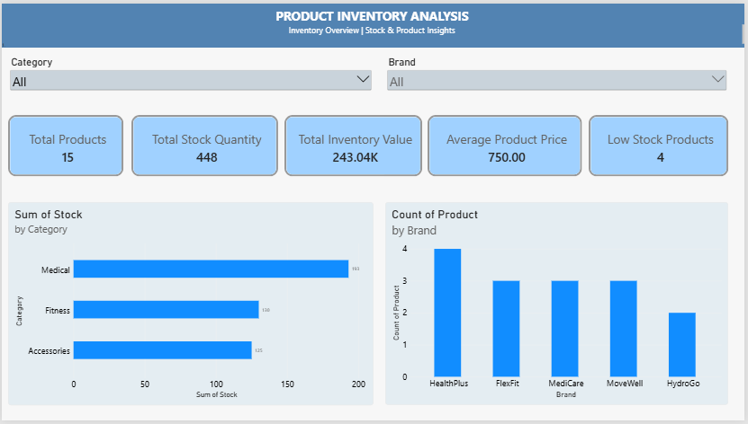

# Product Inventory & Pricing Analysis Dashboard

## Project Overview

An interactive Power BI portfolio project developed to analyze product inventory, stock distribution across categories, brand-level product counts, and product pricing.

This project demonstrates practical skills in data cleaning, data transformation, DAX calculations, data visualization, and business intelligence reporting.

## Tools & Technologies

- **Microsoft Power BI Desktop** — Dashboard development and reporting
- **Power Query** — Data cleaning and transformation
- **DAX (Data Analysis Expressions)** — Measures and calculations
- **Data Visualization** — KPI cards, charts, and interactive slicers
- **GitHub** — Project documentation and version control

## Dashboard Pages

### Page 1: Product Inventory & Pricing Analysis

- KPI cards for total products, total stock quantity, and average product price.
- Stock distribution across product categories.
- Product price comparison.
- Interactive category slicer.
- Data cleaning and transformation using Power Query.

### Page 2: Inventory Overview

- KPI cards for total products, total stock quantity, total inventory value, average product price, and low-stock products.
- Stock quantity comparison by category.
- Product count comparison by brand.
- Interactive category and brand slicers.

## Dashboard Previews

### 1. Product Inventory & Pricing Analysis

### 2. Inventory Overview

## Key DAX Measures

### 1. Total Products

Counts the product records available in the dataset.

### 2. Total Stock Quantity

Calculates the total quantity of stock across product records.

### 3. Average Product Price

Calculates the average price of products in the dataset.

### 4. Total Inventory Value

Estimates the inventory value by multiplying product prices by their stock quantities and summing the results.

### 5. Low Stock Products

Counts product records with a stock quantity below 20, using a defined threshold to identify potentially low inventory.

## Data Preparation

Data preparation was performed using Power Query and included:

- Trimming unnecessary whitespace.
- Removing duplicate records.
- Correcting data types for numerical calculations.
- Preparing data for accurate visualizations and DAX measures.

## Business Value

This project demonstrates how interactive Power BI dashboards can help users:

- Monitor stock distribution across product categories.
- Compare product counts across brands.
- Review average product pricing.
- Estimate the total value of available inventory.
- Identify products below a defined stock threshold.
- Explore inventory data through interactive filters.

## Project Files

- **`Product_Inventory_Analysis.pbix`** — Editable Power BI report containing both dashboard pages.
- **Dashboard PDF exports** — PDF versions of the dashboard pages, uploaded separately.
- **`product-inventory-dashboard.png`** — Preview of the Product Inventory & Pricing Analysis dashboard.
- **`inventory-overview.png`** — Preview of the Inventory Overview dashboard.

## How to Explore the Project

1. Download the `.pbix` file from this repository.
2. Open it using Microsoft Power BI Desktop.
3. Navigate between the dashboard pages using the page tabs.
4. Interact with the category and brand slicers to explore the data.
5. Review the PDF exports for a quick overview of the dashboards.

## Project Deliverables

- Interactive Power BI report.
- Dashboard PDF exports.
- Dashboard preview images.
- DAX measures and data preparation workflow.

## Skills Demonstrated

Power BI | Power Query | DAX | Data Cleaning | Data Visualization | Business Intelligence | Dashboard Development

## Project Type

Portfolio Project | Data Analytics | Business Intelligence
