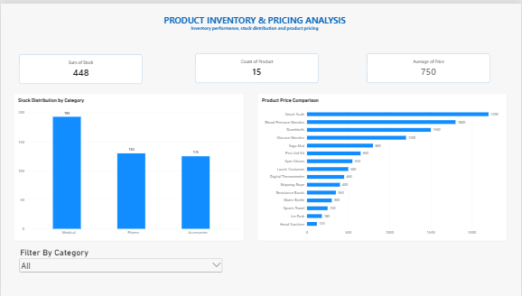

# Product Inventory & Pricing Analysis Dashboard

## Project Overview
An interactive Power BI dashboard developed to analyze product inventory, stock distribution across categories, and product pricing. This project demonstrates data preparation, visualization, and business intelligence skills.

## Tools & Technologies
- Microsoft Power BI
- Power Query
- Data Visualization
- Business Intelligence

## Key Features
- **KPI Cards:** Monitor total stock, product count, and average product price.
- **Stock Distribution by Category:** Compare inventory quantities across categories.
- **Product Price Comparison:** Analyze prices across individual products.
- **Interactive Category Slicer:** Filter dashboard visuals by product category.
- **Data Preparation:** Clean and transform data using Power Query.

## Business Value
The dashboard helps users monitor inventory levels, compare product prices, and identify differences across categories to support data-informed decisions.

## Project Files
- `Product_Inventory_Analysis.pbix` — Editable Power BI report.
- `Product_Inventory_Analysis.pdf` — PDF version of the dashboard.

## Project Type
Portfolio Project | Data Analytics | Business Intelligence

## Dashboard Preview

## Project Deliverables

- **Power BI Dashboard:** Download `Product_Inventory_Analysis.pbix` to explore the editable report in Power BI Desktop.
- **PDF Report:** Download `Product_Inventory_Analysis.pdf` to view the dashboard.
